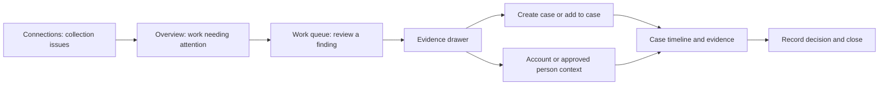

# Argus dashboard workflow: audit, market comparison and implementation plan

30 October 2026. **Proposal for review, not an implemented redesign.**

## Recommendation

Build the analyst journey around **review → evidence → case → decision**.
Argus already collects real evidence and has useful attribution, identity-link
and review safeguards. The main workflow problem is that those capabilities are
spread across pages, while unavailable model panels dominate the account view.
Another round of dashboard charts would not fix that.

The target remains a small organisation's security generalist: make the next
action obvious, show why something needs review, and retain a defensible record
of the analyst's decision. This redesign does not improve the detector itself
or make an unvalidated live model ready.

## 1. What I studied

Reviewed the running overview, alert queue, escalation preview/cancel, identities
timeline, investigations list and an account detail page in a fresh headless
browser. All non-GET requests were blocked: **zero mutations and zero page
errors**. Read the corresponding frontend, alert escalation, investigation
storage, event APIs and identity-link code. No UI, live job, cloud resource,
model or application record was changed during the audit.

The API snapshot had 51 open signals: 33 rule signals, 18 account observations
and zero model detections; one investigation and one approved person identity.
These are timestamped audit observations, not fixed demonstration numbers.

Market comparison uses public vendor documentation, not licensed hands-on
testing, a detector benchmark, price comparison or proof of feature parity.
Microsoft's new incident-case experience and some UEBA capabilities are marked
preview; Splunk and Exabeam naming/availability varies by version/product.

### Verified problems in Argus

| Priority | Current behavior | Analyst impact |
|---|---|---|
| P0 | Home is mainly provider counts and an account table; almost all accounts are unscored | No clear answer to “what should I work on first?” |
| P0 | Navigation alert count mixes new-account observations and security signals | More apparent urgency than the security queue actually contains |
| P0 | Account screen repeats unavailable AE information, shows a green Live AE indicator without a score, and reserves a large empty SHAP panel | Contradictory readiness cues and poor use of space |
| P0 | Live investigations still use “Confirmed Insider” as an outcome | Confuses account compromise, insider activity and benchmark labels |
| P1 | Alert evidence opens as raw details JSON; “Open case” leads to an account page | The analyst must reconstruct the investigation context |
| P1 | Investigation storage is keyed by user/account; escalation links alerts through note text | Cannot cleanly represent two separate incidents for one account, or one case spanning several accounts |
| P1 | Cross-provider timeline lives in the identity-administration page | The project's strongest investigation feature is outside the main investigation journey |
| P1 | Alert origin is filtered client-side after fetching at most 100 newest rows; account feed defaults to 20 events | Older relevant evidence can be unreachable or mistaken for a complete history |
| P1 | Cases, identities, account details and queues do not share an investigation time range or preserved navigation context | Repeated searching and loss of focus |
| P1 | Event display API omits native evidence identifiers and metadata | A case cannot yet link directly to a complete evidence inspector |
| P2 | Source cards refresh, but account/stat data has different refresh behavior; some timestamps use browser-local formatting | Screens can disagree about what is current |

Evidence: `frontend/pages/index.js`, `alerts.js`, `investigations.js`,
`identities.js`, `users/[id].js`; `backend/investigations.py`;
`backend/main.py` alert escalation/event routes; `backend/event_store.py`.

Retain the good foundations: source-scoped native account keys, manual approved
identity links with history, separate signal origins, Unknown instead of fake
Low, explicit escalation confirmation, preserved notes/owner, idempotent
operations, and the newly added collector/workload checks.

## 2. Comparison with market workflows

| Product/documented pattern | What it contributes | Appropriate Argus adaptation |
|---|---|---|
| Microsoft Defender/Sentinel: incidents connect alerts, entities and evidence; case management tracks owner, status and resolution | An investigation has an object and lifecycle distinct from the account | Real case IDs, explicit finding/evidence links, ownership and a closing reason |
| Splunk Enterprise Security 8.4: analyst queue supports time filters, assignment, finding details and adding findings to investigations | Triage and case work stay connected; filters preserve the working context | One queue with a detail drawer, server-side filters and explicit create/add-to-case actions |
| Exabeam Threat Center: prioritized case workspace and contextual threat timeline | Activity around a detection is part of the investigation, not a separate administration task | Case-centered multi-source timeline with alert markers and linked account context |
| Sentinel UEBA investigation guidance: pivot from the incident to entity activity and supporting evidence | An anomaly needs contextual review before a conclusion | Account/person context beside the selected finding; show available evidence and limitations |

Sources: [Microsoft incident overview](https://learn.microsoft.com/en-us/defender-xdr/incidents-overview),
[Microsoft incident-case management, preview](https://learn.microsoft.com/en-us/defender-xdr/manage-incident-cases),
[Splunk analyst queue](https://help.splunk.com/en/splunk-enterprise-security-8/administer/8.4/mission-control/manage-analyst-workflows-using-the-analyst-queue-in-splunk-enterprise-security),
[Exabeam Threat Center feature brief](https://www.exabeam.com/wp-content/uploads/FEATUREBRIEF-Threat-Center.pdf),
[Sentinel UEBA investigation guidance](https://learn.microsoft.com/en-us/azure/sentinel/investigate-with-ueba).

These products also provide capabilities beyond Argus's current scope. This plan
borrows their navigation and evidence patterns; it does not claim equivalent
correlation, automated response, peer baselines or risk scoring. There is no
supported basis here to claim competitors cannot serve SMEs or link cloud accounts.

## 3. Proposed information architecture

Primary navigation: **Overview · Work queue · Cases · Entities · Connections**.
Benchmark replay moves to a clearly labelled secondary **Research / CLUE replay**
entry. It remains accessible, but never appears to be live monitoring.



### Overview: tell the analyst where to start

- Compact counts for unreviewed security findings, active cases and collection
  issues, each linking to the matching filtered view.
- A short work list: unassigned/current cases and recent actionable findings.
- Source health as a compact strip with drill-through to Connections. Keep raw
  ingestion volumes available there rather than making them the main task.
- One concise model-readiness indicator. No repeated empty score/SHAP cards.
- Event-volume charts only if they answer a time-window question and display
  gaps honestly. Do not add random risk trends, geographic maps without data,
  empty comparison charts or a person score assembled from incompatible models.

### Work queue: inspect before opening a case

Default to unreviewed rule/model findings. Keep Observations as a separate tab;
new accounts do not become security detections merely by being observed.
Collection issues remain operational items, not compromise alerts.

Server-side filters: time range, status, origin, severity, provider, account/person
and analyst/assignment. Use stable ordering and pagination with real totals.
Persist filters in the URL; refresh must preserve selection and filter state.

Rows show a readable title, severity, origin, entity, provider, first/last seen,
occurrences, status and linked case. Sort transparently by selected severity and
recency; do not introduce an undocumented risk-ranking model.

Selecting a row opens a drawer with:

1. What triggered the signal and when.
2. Actual rule facts or available model/profile/threshold evidence.
3. Triggering events, related activity and data availability.
4. Actions: acknowledge, close with reason, create case, add to an existing case.

“Review” opens evidence; “Create case” persists a case. Those are distinct actions.
Case creation confirms title, entity scope and owner, then opens the actual case
URL. Closed cases are not silently reopened. Retain the current confirmation and
double-click/idempotency protections.

### Cases: a persistent investigation workspace

Give every case a stable ID and `/cases/<id>` route. Suggested layout:

```text
Case ID · Title                    Priority · Status · Owner
Affected accounts / approved person · Time range · Coverage
-----------------------------------------------------------
Summary | Timeline | Evidence | Notes & activity
-----------------------------------------------------------
Selected events / findings         Entity & evidence drawer
Investigation checklist            Decision and closing notes
```

Use **New / In progress / Closed** as case lifecycle, with a separate resolution:
Security incident confirmed / Expected or authorized activity / Detection false
positive / Insufficient evidence. Closing requires a reason. An anomaly can be
real but authorized; that is not automatically a detector false positive.
Do not label an account's owner an insider because their credentials were misused.

Keep case priority distinct from finding severity and model score. Initial
priority can be an explicitly labelled suggestion based on linked finding
severity; analysts can change it with a recorded reason. No invented 0–100 score.
Case decisions do not rewrite benchmark ground-truth labels or automatically
become AE training data.

Link multiple findings and multiple account entities to one case; allow separate
cases for separate episodes affecting the same account. A finding already linked
to a case should show that relationship, rather than another indistinguishable
standalone work item. Closing a case must not silently mark every associated
finding false positive or resolved; dispositions remain explicit.

### Entities: account evidence and approved person context

Accounts and People are tabs in one explorer. Show entity kind and provenance:
human account, verified bot/service account, controlled workload, or unclassified
where evidence is insufficient. An AWS role is not automatically a machine user;
a `[bot]` name alone is not native identity evidence.

An account view prioritizes recent findings, active cases, time-filtered activity
and the approved person link. Model explanation is one conditional section, not
three score displays. Show raw reconstruction error against its actual calibrated
threshold only for a compatible, released profile; raw MSE is not a 0–1 probability.

The case can expand to accounts through existing approved links. Preserve the
current AWS ownership restriction: the personal timeline currently supports
approved GitHub/human Cloudflare accounts, not unverified root/lab-role ownership.
AWS accounts may be added as **related case entities with a stated reason**;
that association is not proof that they belong to the same person. Do not
auto-link people by matching emails, names or IPs.

Snapshot the case's entity scope and mapping provenance. Later link revocation
must not silently erase historical case evidence; show the historical approval
and its present status. No aggregated person risk score.

### Connections: understand collection without confusing it with detection

Show provider connection, last successful attempt, collector heartbeat, workload
receipts, unresolved/missed actions and available event history. Distinguish
“no activity observed,” “poll failed,” “task stale,” “outcome unresolved,” and
“not configured.” Current operational checks are reusable here.

Provide a contextual link from an investigation when its source/time window lacks
evidence. Event totals alone never become a coverage percentage. Operators can
inspect a missing receipt; the UI does not replay an uncertain cloud action.
Only the actually configured AWS, Cloudflare and GitHub connections belong in
the live inventory. An Entra parser in the repository is not an active connector.

## 4. Data/API work required before the workflow can be credible

This is partly a backend change, not just a layout exercise.

| Area | Minimum implementation |
|---|---|
| Cases | New case ID, title, priority, lifecycle, resolution, owner, time window, creation/update/version fields |
| Associations | Explicit case–finding, case–entity and case–event/evidence tables; no relationships encoded only in note text |
| History | Append-only case activity for ownership, status, scope, evidence links and decisions; optimistic version checks for conflicting edits |
| Findings | Stable rule/detector identity, origin and structured triggering-event references for future alerts; readable evidence summary |
| Evidence | Event reference includes source, collection namespace, native ID, canonical payload digest and stored row reference |
| Queries | Server-side filtering, canonical UTC event ordering, time-range bounds and cursor pagination; expose truncation/has-more |
| Scoring | Reuse actual readiness/profile/threshold metadata; no new detector, thresholds or priority formula |
| Operations | Reuse sanitized collector receipts and keep their states separate from security findings |

Proposed additive APIs: `/workspace/summary`, `/findings`, `/findings/<id>`,
`/cases`, `/cases/<id>`, `/cases/<id>/findings`, `/cases/<id>/entities`,
`/cases/<id>/events`, `/events/<id>` and a filtered entity activity endpoint.
Exact response schemas are a first implementation deliverable, not assumed
existing features. Reuse existing identity APIs and observed-source metadata.

Two important evidence limits:

- Existing event rows retain normalized fields/metadata and native digests;
  the normal display API omits some of these. Full original provider payloads
  are **not uniformly retained**. Show a normalized-evidence inspector first.
  Offer an Original payload view only when a verified retained artifact exists;
  never reconstruct a JSON object and call it the original. Future raw retention
  is a separately bounded ingestion change, not required to fake old evidence.
- Historical alerts may lack an exact triggering-event reference. Preserve them
  as legacy findings, and label time-window matches as related context, not
  proven trigger links. A GitHub provider payload revision is not another action
  or occurrence. Preserve canonical digests and separately labelled revisions.

Grouping is optional presentation assistance: same detector/rule, account,
provider and declared time window. Show the rule, time bounds and member count;
preserve every original finding. No automatic cross-provider attack correlation
or automatic case creation in this iteration.

## 5. Implementation sequence and acceptance gates

Estimate: **6–9 focused engineering days**, plus review/operational buffer.
Target the core workflow by 7 November and stabilize by 15 November. These are
planning estimates, not a promise to weaken tests or protect dates by hiding gaps.

| Phase | Deliverable | Acceptance |
|---|---|---|
| 1 — 0.5–1 day | Confirm navigation, low-fidelity queue/case layouts, API schemas and terminology; remove misleading live-score visuals | One clear analyst journey; missing model produces a compact truthful state; no backend scoring change |
| 2 — 1.5–2 days | Case store, explicit associations, event evidence API and legacy migration | Existing notes/owner/history preserved; two cases for one account and one case for multiple accounts work; retries do not duplicate links |
| 3 — 1.5–2 days | Review queue, drawer, create/add-to-case flow and real case route | Analyst reviews evidence before creating a case; all filters apply before pagination; linked findings stay contextual |
| 4 — 1–2 days | Case timeline, entity context, closure and history | Source/time filters, missing evidence, mapping provenance, resolution notes and concurrent-edit protection work |
| 5 — 0.5–1 day | Connections drill-through, contextual shortcuts and refresh consistency | Collection problems are distinguishable from detections; time range/filter state survives navigation |
| 6 — 1 day | Migration rehearsal, journey testing and presentation readiness | Three realistic journeys pass; rollback verified; existing native collection/model evidence unchanged |

MVP cut line: phases 1–4 plus basic Connections health. Defer decorative charts,
relationship graphs, bulk case merge, automation/playbooks, notifications and
new AI integrations if they threaten the core workflow. Useful existing LLM
guidance may be displayed only where grounded inputs/support already exist;
otherwise use a factual checklist rather than invented AI analysis.

### Protect the experiment and presentation timeline

- Codex owns live-system/UX implementation. Claude owns offline W33 work; Codex
  reviews it without training, releasing or evaluating on Claude's behalf.
- Preserve AWS source-commit target 5 November, rehearsal 6 November and the
  before-8-November bound-source requirement. Avoid further launcher/study-source
  changes after its code freeze. Backend endpoint changes still require reviewed
  runtime pin releases; they do not permit changing normalization, actor behavior
  or feature extraction used by the study.
- W33 freeze stays **15 November 23:59 MYT**, single reserved test **16–17 November**,
  report **17 November**. No early evaluation to supply dashboard numbers.
- After results are reviewed, connect verified benchmark artifacts to the
  separately labelled Research replay for 18–22 November presentation preparation.
  Record any later change affecting reported results. Competition: 25–26 November.
- **Runtime dependency found:** the current local backend launcher expires with
  the collection pilot at 15 November. The competition needs an independently
  available app runtime. Plan a separate presentation/app service before the
  launcher freeze; it must not extend or restart the frozen actor collection.
  After collection ends, show its dated state/Ended status. Cloud hosting is a
  separate deployment decision, not implied by the workflow redesign.

## 6. Migration, verification and rollback

Introduce case tables in the existing transactional store, without rewriting
native event IDs, payload digests or identity mappings. Rehearse against a copy.
Import the existing account-keyed investigation(s) with original notes, analyst,
timestamps and history; retain legacy status as provenance, not newly adjudicated
compromise. Record a migration map from legacy account record to case ID.

Do not keep JSON and the new case tables as competing writable sources. Switch
writers deliberately after verification; keep the legacy snapshot/read path for
rollback. Redirect old investigation links to the mapped case. An old route must
not silently choose a case when several candidates exist. Back up before changes,
verify exact source-pin changes, restart only owned services and confirm backend
identity before resuming jobs. No clear-alerts/reseed workaround.

Required tests focus on behavior, not component implementation:

1. Finding → evidence → new case → timeline → decision, with zero external/cloud
   response action and no automatic conclusion.
2. Existing person with approved GitHub/Cloudflare links → case context; an
   unlinked AWS account remains explicitly unlinked.
3. Collector unresolved/stale → Connections evidence; it does not turn into a
   High-risk user or disappear as Low.
4. Double-submit, retry after response loss, add finding twice, closed-case guard,
   stale editor conflict, case closure reason and append-only change history.
5. Pagination beyond 100 findings and 20 events, late-arriving events, UTC/MYT
   boundaries, malformed/missing timestamps and honest truncation indicators.
6. Replay/live separation, missing AE/SHAP, no 0–1 bar for raw MSE, no inferred
   peer baseline, unchanged frozen artifacts and unchanged native-log counts
   except legitimate concurrent ingestion.

Usability targets for review: from a queue row to the evidence drawer in one
action; from that drawer to a prefilled case in at most two further confirmations;
return to the same queue filter/selection; see linked sources and evidence gaps
without opening identity administration. Validate with scripted tasks and, if
available, the lecturer; do not call these measured user-study results yet.

## Decision

Start with a real case/evidence foundation and one complete investigation journey.
Keep the current ingestion and identity work, remove misleading score emphasis,
and bring the cross-provider evidence into the case. This addresses the current
workflow weakness without adding another dataset, model experiment or unsupported
claim about risk.

Local audit screenshots and browser receipt are in the ignored
`data/live/workflow-audit-20261030/` directory. Screenshots contain native account
identifiers; they are internal review material, not ready for public posters.

## 7. Addendum (Claude, 30 October, agreed with the user): explainability and delivery timing

Proposed additions for Codex review. Sections 1–6 above are not edited.

### 7.1 Explainability: four layers, no SHAP panel

Removing the empty SHAP panel (P0) must not read as removing explainability. Argus explains at
four levels. The evidence drawer and case view show whichever layers actually exist for that
finding, and nothing else.

| Layer | Content | Status |
|---|---|---|
| 1. Model contributions | Per-feature reconstruction contributions. For raw MSE, each contribution is the squared error in the model’s transformed input space divided by the feature count. Contributions sum to raw MSE; they explain its arithmetic, not attack causation or the model’s full reasoning. Any post-processing must be disclosed separately. Shown only for a released, compatible profile, against its actual calibrated threshold; raw MSE is never a 0–1 bar. | Exists in the CLUE replay; live only after a model passes evaluation |
| 2. Behaviour facts | Plain-language, account-relative facts derived from the W33 features, e.g. "120 events, ~4× this account's median", "2 action kinds never seen for this account: …", "60% of today's top-level namespaces are new to this account", "activity 02:00–04:00 UTC vs this account's usual hours", "today mostly sharing; usually reads". Facts require the underlying event/history evidence and a stated reference window; a derived feature alone is not sufficient. Facts only, no intent. | New: offline generator (Claude) |
| 3. Evidence | Triggering and related events with source, collection namespace, native ID, digest and time; the approved cross-provider timeline. | Exists in part; the drawer and case view in this plan complete it |
| 4. Why unscored | Explicit reason: "Unknown — 3 usable days of history, 5 required", "No validated model for this source", "Input incomplete: …". | Exists as Unknown; make the reason visible |

Optional layer 5, grounded summary: an LLM (Gemini/DeepSeek/Groq only, never the Anthropic API)
may summarise layers 1–4 into a short paragraph **only from those supplied facts**, labelled as an
assistant summary, with a factual checklist as the fallback. No invented reasons, intent or risk.

Terminology for the report and UI: "explained by per-feature reconstruction contributions and
account-relative behaviour facts, linked to source evidence". SHAP is mentioned only as FYP1 history
(TreeExplainer on the Isolation Forest; the paper's KernelExplainer statement must be corrected).

Ownership:
- **Claude (offline):** an explanation generator for W33 replay results. For a scored day it outputs
  the top contributing features (layer 1) and the behaviour facts (layer 2), and is tested on
  synthetic data. It runs on real results only after the single 16–17 Nov evaluation. Its output
  feeds the separately labelled Research / CLUE replay page.
- **Codex (live UI):** evidence drawer and case view showing layers 3 and 4 now, and layers 1 and 2
  only when a compatible released profile exists.

### 7.2 Delivery timing and scope: protect the AWS study, the W33 test and the report

The full plan (6–9 engineering days) competes with the AWS commit (5 Nov), the AWS rehearsal
(6 Nov), the AWS freeze and cases (11–14 Nov), the W33 test (16–17 Nov) and the final report
(1 Dec). New backend endpoints require runtime releases and restarts while the AWS pilot still
collects; a restart inside a persona action window risks unrecoverable missed actions.

| When | Work | Constraint |
|---|---|---|
| Now | P0 fixes: compact truthful score states (remove the misleading live-AE indicator and empty SHAP panel, add a visible "why unscored" reason) and clearer finding categories (separate observations from security findings) | Frontend first; no collector, normaliser or study-source change |
| Now (check first) | Replace "Confirmed Insider" for new decisions | **Not assumed frontend-only.** Check whether the API stores that exact status. Existing records keep their historical value and meaning, shown as legacy provenance; they are never silently remapped to a new disposition. |
| Now → 15 Nov | Case store, associations, queue and evidence drawer, built and tested against a **copy** of the store | No live backend restart for this work during AWS collection |
| After 15 Nov | One planned cutover on the separate competition runtime (section 5 runtime dependency) | AWS study ended; frozen artifacts untouched |
| 18–22 Nov | Connect reviewed W33 results and explanations to the Research / CLUE replay page | Results labelled as reserved benchmark evaluation, not live detection |

Cut first if time is short: finding grouping, bulk operations and decorative elements.

Keep, simplified but never dropped:
- **Basic version checks:** a stale edit is refused rather than overwriting another analyst's
  decision or notes.
- **A tested backup → import → rollback path:** rehearsed on a copy before cutover, so existing
  notes, owner, history and legacy statuses cannot be lost.

Keep the journey: one complete finding → evidence → case → decision flow, with the
cross-provider timeline inside the case. That is a stronger proof of concept than more dashboard
panels.

(Revised 30 October after Codex review: edit protection and the migration/rollback rehearsal moved
from the cut list to the keep list; the "Confirmed Insider" change requires an API storage check and
must preserve historical records.)
